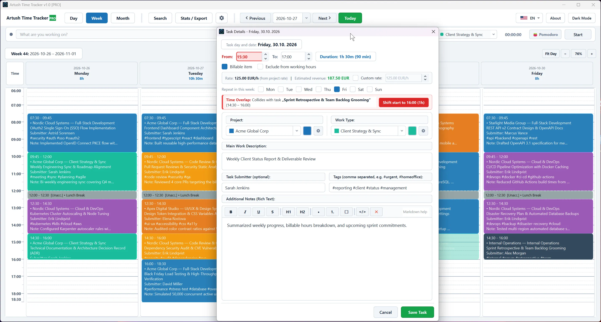
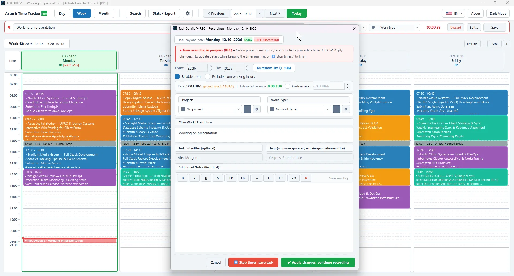
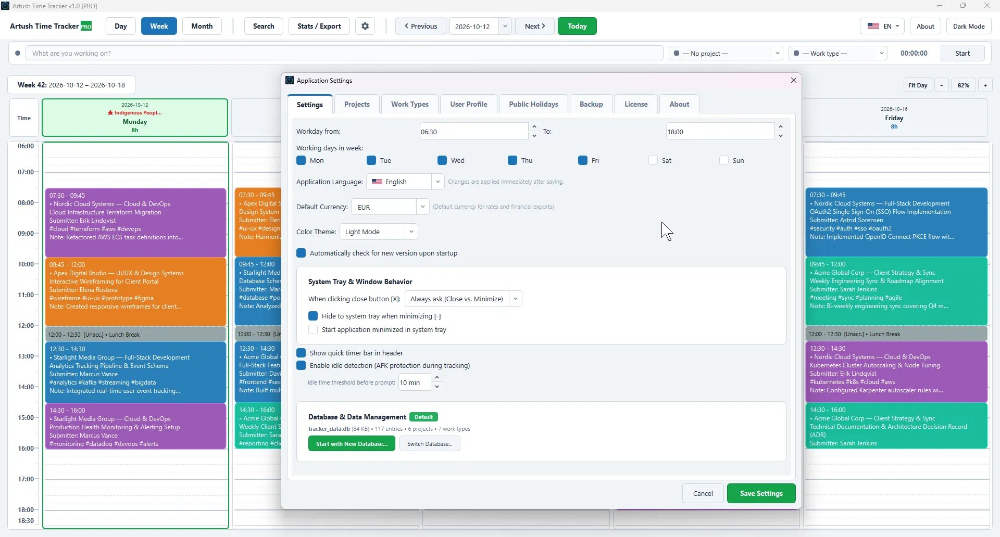
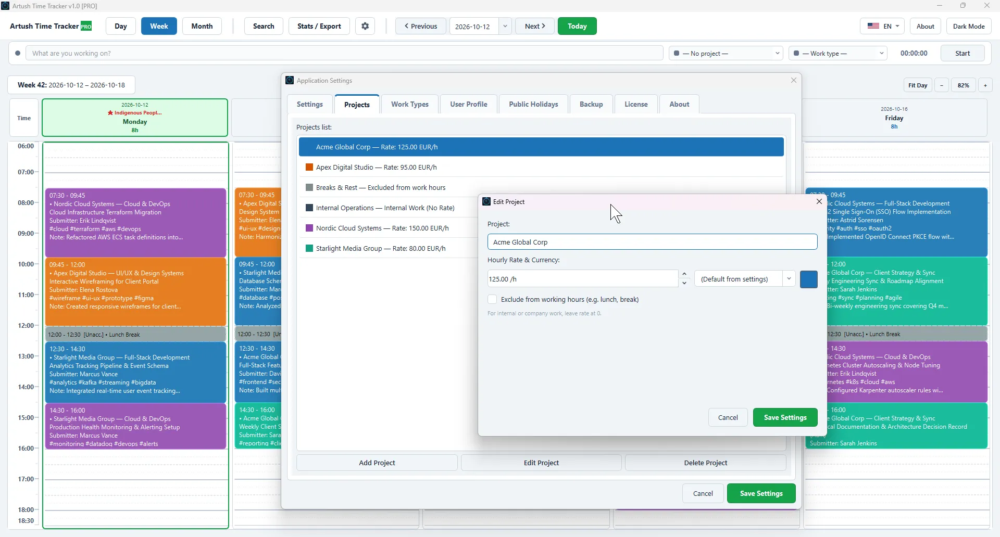
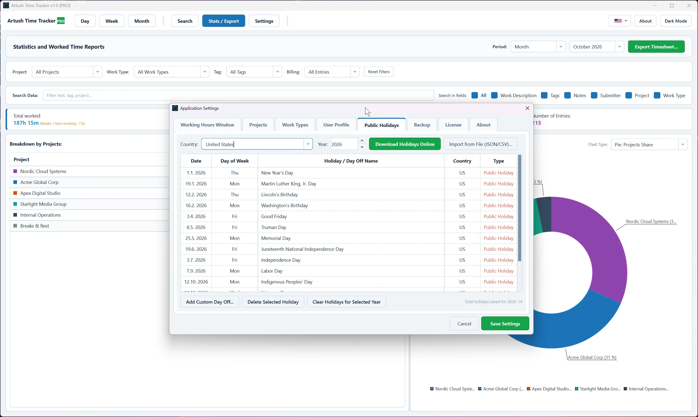

<!-- Cookie Consent Styles and Script -->
<link rel="stylesheet" href="https://cdn.jsdelivr.net/npm/cookieconsent@3/build/cookieconsent.min.css" />

# Artush Time Tracker

  <object type="image/svg+xml" data="time-tracker.svg" title="ArtushVision Time Tracker Features - Visual Timelines and Drag-and-Drop Scheduling" aria-label="ArtushVision Time Tracker Features - Visual Timelines and Drag-and-Drop Scheduling" style="width: 100%; height: auto; display: block;">
    
  </object>

---

**Fast, 100% offline desktop work log, live stopwatch time tracker, and professional billing report generator.**

**Artush Time Tracker** is an intuitive, privacy-first desktop application crafted for freelancers, software developers, IT administrators, consultants, and independent professionals. Track your daily workload with high-precision live stopwatches, organize client projects with customizable hourly rates and multi-currency billing, eliminate time overlap collisions, mirror your backups automatically to cloud storage, and generate executive-ready timesheets in PDF, Excel (.xlsx), and CSV formats without cloud subscriptions, mandatory logins, or third-party telemetry.

  

---

## How Does Artush Time Tracker Work?

**Take full control of your working hours, project billing, and client timesheets in three easy steps:**

### 1. Start Tracking Instantly or Plan Visually
Begin logging immediately with the **One-Click Record Action (`▶ Start` / `⏹ Save`)** located right in the top navigation bar, or visually create tasks on the interactive **Day**, **Week**, or **Month** timelines. Select a client project and activity type, or simply type a task title for spontaneous standalone tasks without picking a project. Mark entries as billable or non-billable, and take advantage of automatic hourly rate calculation with custom rate overrides. Need to record an unpaid lunch or break? Simply check the box to exclude it from your productive work hours with one click.

### 2. Prevent Scheduling Conflicts Automatically
Artush Time Tracker features an intelligent collision protection engine. If a newly created task, live recorded block, or dragged time entry overlaps with an existing appointment, the system immediately flags the conflict and suggests optimal start and end times to fit your schedule without tedious recalculation.

### 3. Generate Professional Client Timesheets & Invoices
Filter your workload by project, date range, activity type, or custom tags. Export polished **PDF timesheets** complete with analytics charts, itemized earnings, and official Sign-Off signature sections, structured **Excel spreadsheets (.xlsx)** with native column charts and summary sheets, or standard **CSV files** ready for your accounting system.

---

### Why Choose 100% Offline & Zero-Cloud Tracking?

Unlike modern cloud trackers that store sensitive client names, financial rates, and proprietary work descriptions on remote servers:

* **Your Data Stays on Your Machine:** Everything is stored locally in a secure SQLite database (`tracker_data.db`).
* **Zero Telemetry & Zero Tracking:** No activity logs, tracking scripts, or analytics beacons leave your computer.
* **Dual-Layer Data Protection & Automated Cloud Mirroring:** Enjoy the privacy of local storage combined with the safety of the cloud. In addition to local automatic rotating database backups on startup, Artush Time Tracker can automatically mirror every backup ZIP archive directly to your preferred cloud folder (OneDrive, Google Drive, Dropbox) or external network NAS / USB drive.
* **Instant Speed & No Latency:** Enjoy blazing-fast UI responsiveness, smooth zooming, and instant search without relying on an active internet connection.

---

### Designed for Every Professional Workflow

Whether you bill multiple external clients by the hour or track internal engineering sprint tasks, Artush Time Tracker fits your routine:

* **Software Developers & DevOps Engineers:** Track sprints, customer deployments, bug fixes, and server maintenance with `#tags` and rich notes.
* **Freelancers & Contractors:** Keep precise records of billable vs. non-billable hours, apply custom task rate overrides for rush/night assignments, calculate projected earnings in real time across multiple currencies, and provide clients with verifiable timesheets.
* **IT Support & Systems Administrators:** Document tickets, client visits, task requestors (*submitters*), and issue resolutions.
* **Consultants, Designers & Photographers:** Easily switch between projects, monitor project time budgets, and review monthly workload distribution.

---

## Key Features and Benefits

Everything you need to master your schedule, track billable time, and generate flawless timesheets:

* **One-Click Record Action & Real-Time "REC" Stopwatch**  
  Always ready at the very top of your screen: start, stop, or discard time recording instantly using the primary **Record Action button (`▶ Start` / `⏹ Save`)** paired with a live digital stopwatch (`00:00:00`). While recording, your active task pulses live on the Day timeline as an expanding `● REC` block with a vibrant red indicator line, and real-time counters dynamically update your daily and weekly progress. Need to assign a project, add tags, or write notes while working? Open the in-flight editor (`✎` or double-click the pulsing `● REC` block) and select *Apply Changes & Continue* to update details seamlessly without interrupting the running clock.

* **Crash-Resilient State Recovery**  
  Never lose tracked time due to unexpected Windows restarts, system crashes, or power outages. The Quick-Timer continuously persists active timer state, start timestamp, and elapsed seconds in real time, automatically restoring your running session upon launching the app.

* **Smart AFK & Idle Time Protection**  
  Stepped away from your desk while a timer was running? The native Windows idle monitor detects inactivity without third-party dependencies and prompts you upon your return. Seamlessly choose to keep the logged time, deduct the idle duration, or automatically split the idle period into a separate unpaid break.

* **Automated Cloud Drive & External NAS Mirroring**  
  Never worry about hard drive failures or machine damage. With built-in Cloud Mirroring, every timestamped backup ZIP archive created on startup or on demand is automatically mirrored to your chosen folder — seamlessly syncing with **Microsoft OneDrive**, **Google Drive**, **Dropbox**, local network **NAS**, or an external **USB drive**.

* **Global Multilingual Support (19 Languages with Flag Icons)**  
  Artush Time Tracker is fully localized into **19 languages** with native names and visual flag icons directly in the top navigation bar and settings:  
  **Čeština**, **English**, **Slovenčina**, **Deutsch**, **Polski**, **Español**, **Français**, **Italiano**, **Português**, **Русский**, **Українська**, **Magyar**, **Türkçe**, **Tiếng Việt**, **简体中文**, **日本語**, **한국어**, **العربية**, and **עברית**. Native Qt locales ensure calendar days, months, and numbers format naturally according to your region.

* **Visual Calendar Timelines (Day, Week & Month Views)**  
  Seamlessly navigate your schedule with responsive calendar layouts. Smoothly zoom the daily timeline from 50% to 300% (or press `Ctrl+0` to fit the whole workday on screen). Double-click or click-and-drag to create tasks, and grab top/bottom edge handles to adjust task durations with 15-minute snapping.

* **Effortless Week Navigation with Shift + Mouse Wheel**  
  Navigate through time with natural gestures: simply hold **`Shift + Mouse Wheel`** anywhere in the Week view (or use `Shift+Left` / `Shift+Right`) to flip forward and backward between weeks instantly. Seamless edge auto-scrolling lets you drag tasks across week boundaries with ease.

* **Drag-and-Drop Task Moving & Instant Duplication (`Ctrl` Clone)**  
  Reschedule work effortlessly by dragging tasks between days or time slots. Need to duplicate an existing entry? Simply hold **`Ctrl`** while dropping to clone the task instantly.

* **Multi-Day Task Replication**  
  Quickly copy standing tasks or daily meetings across all selected workdays in the current week with a single click.

* **Intelligent Conflict & Overlap Protection**  
  Never double-book yourself. The real-time collision detection system alerts you when tasks collide and offers one-click automatic adjustments to fit open slots.

* **Flexible Tasks Without Assigned Projects**  
  Log quick ad-hoc tasks, personal reminders, or miscellaneous work with just a title and description, without being forced to pick a client or activity type.

* **Flexible Billing Hierarchy, Multi-Currency & Task Rate Overrides**  
  Assign custom color codes, distinct hourly rates, and specific currencies (CZK, EUR, USD, GBP, CHF) to each client or project, or define non-billable internal work (0.00 rate). For special assignments, night shifts, emergency interventions, or flat-rate jobs, easily override the project rate directly inside the task dialog. A live interactive rate preview computes your estimated earnings on the fly as you adjust task times.

* **System Tray Background Tracking & Smart Window Management**  
  Keep timers ticking quietly in the Windows System Tray without cluttering your desktop. Configure the close button `[X]` to minimize directly to the tray or quit the application, with an optional prompt and "remember my choice" preference.

* **Responsive Layout & Laptop-Optimized UI**  
  Engineered for all screen sizes — from ultra-wide 4K workstations to compact 1080p laptops with Windows 125%/150% display scaling. Scrollable dialogs with permanently docked action bars guarantee controls never get pushed behind the Windows taskbar.

* **Rich Text Notes & Task Metadata**  
  Add detailed documentation with rich text formatting (bold, italics), assign task requestors (*submitter*), and organize work using searchable `#tags`.

* **Public Holidays & Custom Time Off**  
  Download official national holidays online for any country and year, import holiday datasets from JSON/CSV files, or add company-specific time off.

* **Deep Visual Analytics & Interactive Charts**  
  Explore your working habits with dynamic pie charts (project and activity breakdown) and bar charts (daily hours progression and comparative project volumes).

* **Executive PDF Timesheets with Sign-Off Sections**  
  Export client-ready PDF documents featuring executive summaries with total invoiced amounts, embedded high-resolution charts, full task logs with individual earnings, and formal Employee & Manager signature lines.

* **Structured Excel (.xlsx) & CSV Exports**  
  Generate multi-tab Excel workbooks containing detailed task logs with hourly rates and calculated amounts, project summary tables, and embedded column charts, or export clean CSV files with dedicated rate and amount columns for external ERP workflows.

* **Lightning-Fast Global Search (Ctrl+F)**  
  Search across all historic tasks by keyword, project, work type, requestor, tags, or rich notes with instant date-filtering.

* **Light & Dark Modern Themes**  
  Switch instantly between an elegant Dark Mode and a crisp Light Mode tailored for optimal readability during day or night work.

---

## App Controls & Navigation

Artush Time Tracker is organized into clean, dedicated modules accessible via the top navigation bar:

### 1. Quick-Timer Bar (Top Navigation Bar)
* **One-Click Record Action (`▶ Start` / `⏹ Save`):** High-visibility primary action button to start recording immediately or finish and commit the logged task into your calendar.
* **Live Digital Stopwatch Display:** Real-time ticking counter (`00:00:00`) showing exact elapsed time.
* **Inline Task Setup:** Enter task descriptions and pick client projects or activity categories on the fly, or log standalone tasks without assignments.
* **In-Flight Editing (`✎`):** Click the edit icon during active recording to assign notes, tags, or projects and choose *Apply Changes & Continue* without stopping the clock, or *Stop & Save* when finished.
* **Discard Protection (`✕`):** Safely discard accidental timer starts with confirmation safeguards (>30s) to prevent losing intentional sessions.
* **Language Switcher with Visual Flags:** Quick-switch between 19 languages directly from the top bar with visual flag icons (e.g., `[ 🇨🇿 CZ ▾ ]` or `[ 🇺🇸 EN ▾ ]`).

### 2. Day View
* **Timeline Canvas:** Displays your full workday with configurable working hours (e.g., 07:30 – 17:30).
* **Live "REC" Visual Block:** Active recordings appear dynamically on the timeline in recording red with a ticking duration counter, live title, and a red current-time marker. Double-clicking the `● REC` block opens the live task editor directly.
* **Smooth Zooming:** Use `Ctrl + Mouse Wheel`, `Ctrl++` / `Ctrl+-`, or click `Fit Day` (`Ctrl+0`) to scale your timeline comfortably.
* **Fast Day Navigation:** Use `Alt + Left/Right` or `Shift + Left/Right` to jump between consecutive days.
* **Task Management:** Double-click or click-and-drag to create new tasks; drag top/bottom edge handles to resize durations with 15-minute snapping; right-click to edit, replicate across days, or delete.
* **Header Summary:** Real-time counters showing **Total Worked Hours**, **Billable Time**, **Break / Unpaid Time**, and **Estimated Gross Revenue** (with multi-currency aggregation), updated dynamically while timers record.
* **Interactive Timeline Tooltips:** Hover over any task block to inspect its full billing status, applied hourly rate, and calculated monetary reward in real time.

### 3. Week View
* **Comprehensive 7-Day Grid:** Displays all working days alongside configured work hours and weekend slots.
* **Shift + Mouse Wheel Week Navigation:** Hold `Shift` and scroll your mouse wheel anywhere on the week canvas to flip backward and forward between weeks effortlessly. You can also use `Shift+Left` / `Shift+Right` or `Alt+Left` / `Alt+Right`.
* **Drag-and-Drop Rescheduling & `Ctrl` Cloning:** Effortlessly move tasks between days and hours with instant collision feedback, or hold `Ctrl` while dragging to duplicate tasks.
* **Edge Auto-Scrolling:** Dragging a task near the top or bottom edge of the timeline automatically scrolls the viewport smoothly.
* **Live Week Tracker Badge:** Today's column dynamically displays `● REC +XXm` reflecting in-flight timer progress in real time.
* **Batch Copy to Workdays:** Right-click any task to replicate it across all remaining business days of the week.

  

### 4. Month View
* **Calendar Overview:** Quick visual orientation across every day of the month.
* **Daily Totals & Holidays:** Highlights official public holidays, custom non-working days, and total logged hours for each date.
* **One-Click Day Jump:** Click any calendar cell to instantly open and edit that specific day.

  

### 5. Global Search (`Ctrl+F`)
* **Multi-Field Filtering:** Search through task titles, rich notes, tags (`#tag`), submitters, projects, and work types simultaneously.
* **Time Range Selector:** Filter searches by *Current Week*, *Current Month*, *Current Year*, *All Time*, or a *Custom Date Range*.
* **Direct Navigation:** Click **View Day →** next to any search result to open the day view at the exact time slot.

 

### 6. Statistics & Analytics
* **Summary Metrics:** Instant computation of Total Logged Hours, Billable Time, Non-Billable Time, Breaks, and Estimated Gross Revenue grouped by currency.
* **Project & Activity Breakdowns:** Clean data tables showing total hours, billable percentages, and financial summaries per client.
* **Interactive Chart Engine:**
  * **Pie Charts:** Project distribution and Work type share.
  * **Bar Charts:** Daily hours progression, project volume comparisons, and activity distribution.

### 7. Settings & Administration
* **Working Hours & Schedule:** Configure daily start/end hours and active business days (e.g., Mon–Fri or custom shifts).
* **AFK / Idle Detection Settings:** Configure inactivity threshold duration in minutes or toggle AFK monitoring on/off.
* **System Tray & Window Close Behavior:** Choose default window close behavior (minimize to system tray vs. exit application).
* **Language & Default Currency:** Choose from 19 languages with visual flag icons, and select default global currency (`Kč`, `EUR`, `USD`, `GBP`, `CHF`, or custom).
* **Projects & Rates:** Add, edit, or color-code client accounts with individual hourly rates, custom project currencies, and non-billable designations.
* **Activity Types:** Customize work categories (Software Development, Meetings, IT Support, Consulting) with Google-palette colors.
* **Worker & Approver Profiles:** Set up employee name, department/ID, and supervisor name for automatic inclusion in exported timesheets.
* **Public Holiday Manager:** Fetch official country holidays over the web, import JSON/CSV calendars, or log custom vacation dates.
* **Backup & Cloud Mirroring Hub:** Manage local automatic startup backups, export timestamped ZIP archives, or set up automatic mirroring to external cloud/NAS folders (OneDrive, Google Drive, Dropbox, local NAS, USB).

---

## Power-User Cheatsheet (Shortcuts & Gestures)

| Action | Shortcut / Mouse Gesture | Context |
| :--- | :--- | :--- |
| **Start / Stop Timer (Record Action)** | Click `▶ Start` / `⏹ Save` | Top Quick-Timer Bar |
| **Edit Active Timer In-Flight** | Click `✎` or double-click `● REC` block | Quick-Timer / Day Timeline |
| **Flip Between Weeks** | **`Shift + Mouse Wheel`** (or `Shift + Left/Right`) | Week View |
| **Zoom Timeline** | `Ctrl + Mouse Wheel` (or `Ctrl++` / `Ctrl+-`) | Day & Week Views |
| **Fit Workday to Window** | `Ctrl + 0` | Day & Week Views |
| **Jump to Previous / Next Day** | `Alt + Left/Right` (or `Shift + Left/Right`) | Day View |
| **Duplicate / Clone Task** | Hold **`Ctrl`** while Dragging & Dropping | Day & Week Views |
| **Resize Task Duration** | Drag top or bottom edge handles (15m snap) | Day View |
| **Create New Task** | Click & drag vertically, or double-click blank space | Day View |
| **Global Search** | `Ctrl + F` | Anywhere |
| **Quick Language Switch** | Click flag dropdown in navbar (`[ 🇨🇿 CZ ▾ ]`) | Top Bar |

---

## Timesheet Reporting & Export Formats

Export your work logs accurately with versatile filtering (by client, work type, tag, billable status, or custom query):

### 1. Professional PDF Timesheet Reports 📄
* **Executive Overview:** Clear report title, specified date range, worker identification, project metadata, and **Total Invoiced Amount** (with multi-currency support).
* **Embedded Analytics Charts:** Include pie charts (project breakdown), daily bar charts, or both directly inside the document.
* **Detailed Work Log:** Structured table listing date, time slot, duration, title, project, activity type, billable status, and **individual task earnings**.
* **Formal Sign-Off Block:** Pre-formatted signature and approval lines for contractor/employee and managing approver.

### 2. Microsoft Excel Workbooks (`.xlsx`) 📊
* **Sheet 1 (Detailed Timesheet):** Clean chronological entries with date, start/end times, project name, activity, submitter, tags, duration, **hourly rate**, and **calculated amount**.
* **Sheet 2 (Project Summary & Chart):** Automated summary aggregation by project paired with an Excel native column chart.

### 3. Standard CSV Spreadsheets (`.csv`) 📋
* Semicolon-delimited UTF-8 format featuring dedicated **Rate** and **Amount** columns for frictionless import into QuickBooks, Xero, FreshBooks, SAP, Pohoda, Money S3, or custom SQL databases.

---

## Fair & Transparent Licensing (Free vs. PRO)

Artush Time Tracker is crafted with respect for user freedom and fair pricing:

| Feature / Capability | Free Edition (FREE) | Professional Edition (PRO) |
| :--- | :---: | :---: |
| **Unlimited Time Logging & Tasks** | ✅ Yes | ✅ Yes |
| **Header Quick-Timer & Live REC Recording** | ✅ Yes | ✅ Yes |
| **Smart AFK & Idle Detection** | ✅ Yes | ✅ Yes |
| **19 Languages with Visual Flag Icons** | ✅ Yes | ✅ Yes |
| **Automated Local & Cloud Mirroring Backups** | ✅ Yes | ✅ Yes |
| **Unlimited Projects & Clients** | ✅ Yes | ✅ Yes |
| **Flexible Hourly Rates, Currencies & Task Overrides** | ✅ Yes | ✅ Yes |
| **Commercial & Personal Usage** | ✅ Permitted | ✅ Permitted |
| **100% Offline & Zero Cloud Lock-in** | ✅ Yes | ✅ Yes |
| **Day, Week & Month Calendar Views** | ✅ Yes | ✅ Yes |
| **Shift + Wheel Week Navigation & Drag-and-Drop** | ✅ Yes | ✅ Yes |
| **Collision Protection & Smart Adjustments** | ✅ Yes | ✅ Yes |
| **PDF, Excel (.xlsx) & CSV Exports** | ✅ Full Access | ✅ Full Access |
| **Analytics Charts & Revenue Estimates** | ✅ Full Access | ✅ Full Access |
| **Holiday Downloads & ZIP Snapshots** | ✅ Full Access | ✅ Full Access |
| **Instant Navigation (Zero Countdowns)** | 15s sponsor countdown on advanced modules | ⚡ Instant immediate access |
| **Price** | **Free Forever** | **€5.99 (One-Time Perpetual License)** |

> [!NOTE]
> The **Free Edition** is completely usable without any expiration date or task caps. Purchasing a **PRO License** for just €5.99 on [Polar.sh](https://polar.sh) removes all sponsor countdown windows permanently and supports independent software development.

  
  
  

---

## Installation & System Requirements

* **Operating System:** Windows 10 / Windows 11 (64-bit).
* **Disk Space:** Less than 100 MB.
* **Dependencies:** 100% self-contained application, zero external database servers, runtimes, or cloud dependencies required.

### Choose Your Preferred Setup:

* **Standard Windows Installer (`.exe`):**
  Recommended for most users. Run `ArtushTimeTracker_Setup_v1.0.exe` for a standard guided setup. Automatically creates Desktop and Start Menu shortcuts and registers a clean uninstaller. Safe updates preserve your existing database and settings.

* **Portable Edition (`.zip`):**
  Ideal for USB flash drives, restricted corporate PCs, or running without administrator privileges. Simply extract `Artush_Time_Tracker_portable_1.0.zip` into any folder and launch `ArtushTimeTracker.exe`. Leaves no traces in the Windows Registry and keeps everything completely self-contained.

---

## Links & Downloads

**Artush Time Tracker (Desktop Application for Windows)**

[**Download Artush Time Tracker for Windows from GitHub (Free Version)**](https://github.com/Artushfoto/ArtushTime-Tracker/releases/) *(Latest Stable Release)*

---

<table style="width: 100%; display: table; border-collapse: collapse; margin-top: 20px;">
  <tr>
    <th style="text-align: center; padding: 25px 15px; background-color: rgba(0, 164, 239, 0.08); border: 1px solid rgba(0, 164, 239, 0.3); border-radius: 6px;">
      <!-- Status Badge / Button -->
      

        <!-- Microsoft Logo SVG -->
        <svg width="20" height="20" viewBox="0 0 24 24" fill="none" xmlns="http://www.w3.org/2000/svg" style="flex-shrink: 0;">
          <path d="M1 1H10.5V10.5H1V1Z" fill="#F25022"/>
          <path d="M13.5 1H23V10.5H13.5V1Z" fill="#7FBA00"/>
          <path d="M1 13.5H10.5V23H1V13.5Z" fill="#00A4EF"/>
          <path d="M13.5 13.5H23V23H13.5V13.5Z" fill="#FFB900"/>
        </svg>
        Microsoft Store – Certification in Progress
      

    </th>
  </tr>
  <tr>
    <td style="text-align: center; padding: 15px 10px 5px 10px;">
      <b>Direct download via Microsoft Store coming very soon</b>
    </td>
  </tr>
  <tr>
    <td style="text-align: center; padding: 5px 8px 15px 8px; font-size: 0.9em; color: #666;">
      Under review &bull; Automatic background updates &bull; Certified &amp; verified by Microsoft
    </td>
  </tr>
</table>

<table style="width: 100%; display: table; border-collapse: collapse; margin-top: 20px;">
  <tr>
    <th style="text-align: center; padding: 25px 15px; background-color: rgba(45, 164, 78, 0.1); border: 1px solid rgba(45, 164, 78, 0.3); border-radius: 6px;">
      <a href="https://buy.polar.sh/polar_cl_XeIcjrX0VuAY1mG4nZkEt1nCJCZyCvpKujQ1k1wTiCW" title="Proceed to secure checkout for Artush Time Tracker" class="btn btn-success" style="width: 100%; max-width: 400px; font-size: 1.1em; padding: 15px; margin: 0 auto; display: inline-block; text-decoration: none;">👉 CLICK TO BUY - Secure Checkout</a>
    </th>
  </tr>
  <tr>
    <td style="text-align: center; padding: 15px 10px 5px 10px;">
      <b>Perpetual PRO License - Only €5.99</b> (+ local VAT)
    </td>
  </tr>
  <tr>
    <td style="text-align: center; padding: 5px 8px 15px 8px; font-size: 0.9em; color: #666;">
      One-time payment &bull; Lifetime access &bull; Microsoft Store approval currently in progress
    </td>
  </tr>
</table>

---

### Related Software

[**ArtushVision AI – Professional Metadata Automation & Geotagging**](https://vision.artushfoto.eu)  
The Ultimate AI-Powered Workstation for Microstock Metadata, SEO Optimization, and Batch FTP Distribution with Built-in Market Intelligence..

[**Artush GPX Tracker (🤖 Android Mobile App)**](https://play.google.com/apps/testing/com.artush.gpxtracker)  
Lightweight, ad-free mobile GPS track logger for photographers and outdoor photo geotagging.

---

### Privacy, Permissions & Security

* **100% Offline Operation:** All database records, clients, rates, and notes remain strictly on your local disk (`tracker_data.db`).
* **Zero Telemetry:** The application contains no background analytics scripts, telemetry beacons, or third-party tracking cookies.
* **Network Usage:** The application accesses the internet exclusively upon direct user action (e.g., downloading public holiday calendars or verifying a Polar.sh license key).

---

[🔒 Privacy Policy](privacy.html)

[📷 Developer's Photography Portfolio: artushfoto.eu](https://artushfoto.eu)

---

*Artush Time Tracker — precise time tracking, intuitive scheduling, and effortless client billing.*

<!-- Deferred and conditional loading of Google Analytics respecting Cookie Consent -->

