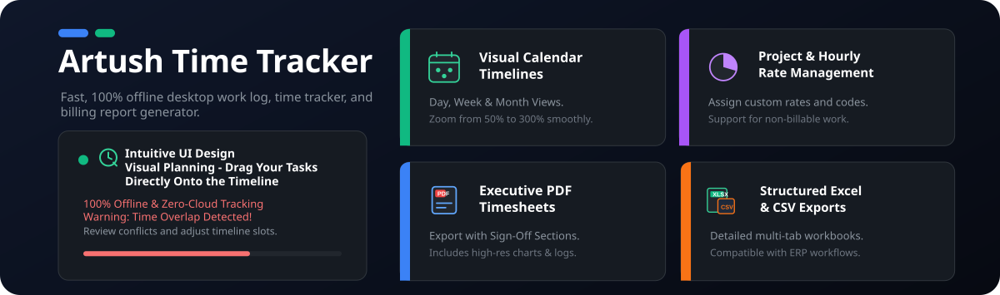
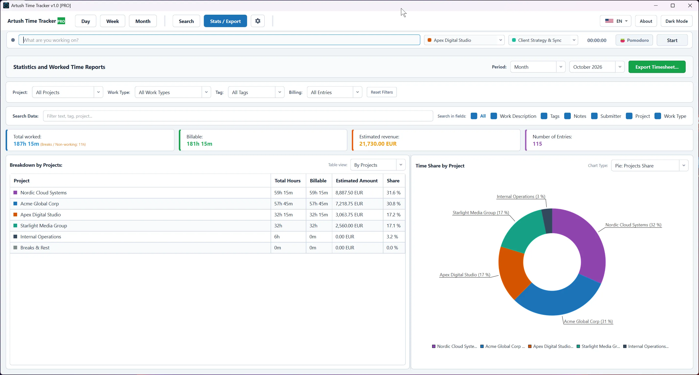
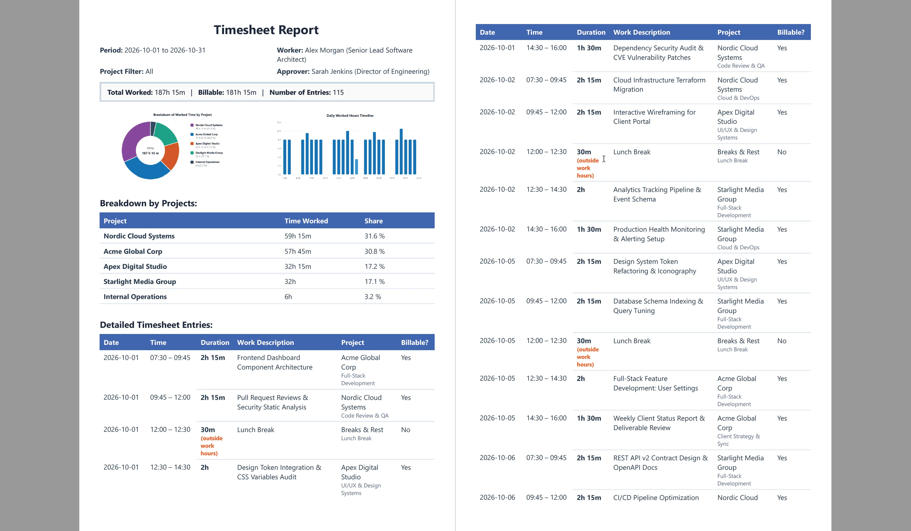
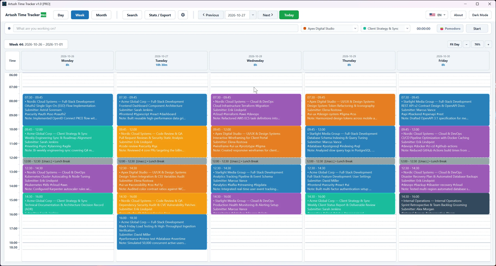
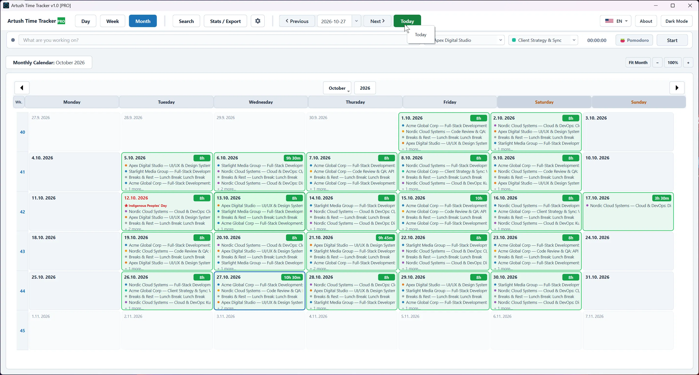
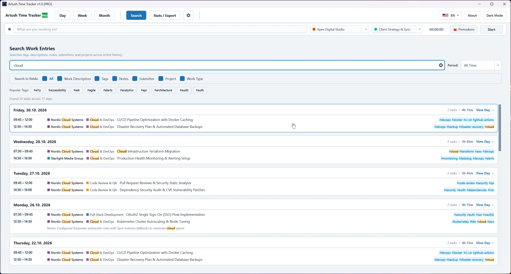

<!-- Cookie Consent Styles and Script -->
<link rel="stylesheet" href="https://cdn.jsdelivr.net/npm/cookieconsent@3/build/cookieconsent.min.css" />

# Artush Time Tracker

  <object type="image/svg+xml" data="time-tracker.svg" title="ArtushVision Time Tracker Features - Visual Timelines and Drag-and-Drop Scheduling" aria-label="ArtushVision Time Tracker Features - Visual Timelines and Drag-and-Drop Scheduling" style="width: 100%; height: auto; display: block;">
    
  </object>

---

**Fast, 100% offline desktop work log, time tracker, and billing report generator.**

**Artush Time Tracker** is an intuitive, privacy-first desktop application crafted for freelancers, software developers, IT administrators, consultants, and independent professionals. Track your daily workload, organize client projects with customizable hourly rates, eliminate time overlap collisions, and generate executive-ready timesheets in PDF, Excel (.xlsx), and CSV formats — without cloud subscriptions, mandatory logins, or third-party telemetry.

  

---

## How Does Artush Time Tracker Work?

**Take full control of your working hours, project billing, and client timesheets in three easy steps:**

### 1. Plan & Log Your Daily Work
Add work blocks quickly across intuitive **Day**, **Week**, or **Month** views. Select the client project, specify the activity type, assign hourly rates, add rich text notes, or tag specific tasks (e.g., `#urgent`, `#meeting`, `#remote`). Need to log an unpaid lunch or break? Simply mark it to exclude it from your billable work hours with a single click.

### 2. Prevent Scheduling Conflicts Automatically
Artush Time Tracker features an intelligent collision protection engine. If a newly created task or dragged time block overlaps with an existing appointment, the system immediately flags the conflict and suggests optimal start and end times to fit your schedule without tedious recalculation.

### 3. Generate Professional Client Timesheets & Invoices
Filter your workload by project, date range, activity type, or custom tags. Export polished **PDF timesheets** complete with analytics charts and official Sign-Off signature sections, structured **Excel spreadsheets (.xlsx)** with native column charts and summary sheets, or standard **CSV files** ready for your accounting system.

---

### Why Choose 100% Offline & Zero-Cloud Tracking?

Unlike modern cloud trackers that store sensitive client names, financial rates, and proprietary work descriptions on remote servers:

* **Your Data Stays on Your Machine:** Everything is stored locally in a secure SQLite database (`tracker_data.db`).
* **Zero Telemetry & Zero Tracking:** No activity logs, tracking scripts, or analytics beacons leave your computer.
* **Full Data Ownership & Safety Backups:** Built-in automatic rotating database backups on startup, paired with one-click full ZIP archive exports and instant restore with safety rollbacks.
* **Instant Speed & No Latency:** Enjoy blazing-fast UI responsiveness and smooth zooming without relying on an active internet connection.

---

### Designed for Every Professional Workflow

Whether you bill multiple external clients by the hour or track internal engineering sprint tasks, Artush Time Tracker fits your routine:

* **Software Developers & DevOps Engineers:** Track sprints, customer deployments, bug fixes, and server maintenance with `#tags` and rich notes.
* **Freelancers & Contractors:** Keep precise records of billable vs. non-billable hours, calculate projected earnings, and provide clients with verifiable timesheets.
* **IT Support & Systems Administrators:** Document tickets, client visits, task requestors (*submitters*), and issue resolutions.
* **Consultants, Designers & Photographers:** Easily switch between projects, monitor project time budgets, and review monthly workload distribution.

---

## Key Features and Benefits

Everything you need to master your schedule, track billable time, and generate flawless timesheets:

* **Visual Calendar Timelines (Day, Week & Month Views)**  
  Seamlessly navigate your schedule with responsive calendar layouts. Smoothly zoom the daily timeline from 50% to 300% (or use `Ctrl+0` to fit the whole workday on screen).

* **Intelligent Conflict & Overlap Protection**  
  Never double-book yourself. The real-time collision detection system alerts you when tasks collide and offers one-click automatic adjustments to fit open slots.

* **Multi-Day Task Replication**  
  Quickly copy standing tasks or daily meetings across all selected workdays in the current week with a single click.

* **Project & Hourly Rate Management**  
  Assign custom color codes and distinct hourly rates to each client or project. Support for internal / non-billable work (0.00 rate) and unpaid breaks.

* **Rich Text Notes & Task Metadata**  
  Add detailed documentation with rich text formatting (bold, italics), assign task requestors (*submitter*), and organize work using searchable `#tags`.

* **Public Holidays & Custom Time Off**  
  Download official national holidays online for any country and year, import holiday datasets from JSON/CSV files, or add company-specific time off.

* **Deep Visual Analytics & Interactive Charts**  
  Explore your working habits with dynamic pie charts (project and activity breakdown) and bar charts (daily hours progression and comparative project volumes).

* **Executive PDF Timesheets with Sign-Off Sections**  
  Export client-ready PDF documents featuring executive summaries, embedded high-resolution charts, full task logs, and formal Employee & Manager signature lines.

* **Structured Excel (.xlsx) & CSV Exports**  
  Generate multi-tab Excel workbooks containing detailed task logs, project summary tables, and embedded column charts, or export clean CSV files for external ERP workflows.

* **Lightning-Fast Global Search (Ctrl+F)**  
  Search across all historic tasks by keyword, project, work type, requestor, tags, or rich notes with instant date-filtering.

* **Light & Dark Modern Themes**  
  Switch instantly between an elegant Dark Mode and a crisp Light Mode tailored for optimal readability during day or night work.

* **Reliable ZIP Backup & Restore Center**  
  Safeguard your data with automatic startup backups, manual timestamped ZIP archive exports, and pre-restore emergency snapshots.

---

## App Controls & Navigation

Artush Time Tracker is organized into clean, dedicated modules accessible via the top navigation bar:

### 1. Day View
* **Timeline Canvas:** Displays your full workday with configurable working hours (e.g., 07:30 – 17:30).
* **Smooth Zooming:** Use `Ctrl + Mouse Wheel`, `Ctrl++` / `Ctrl+-`, or click `Fit Day` (`Ctrl+0`) to scale your timeline comfortably.
* **Task Management:** Double-click or click-and-drag to create new tasks; right-click to edit, copy, paste, or delete.
* **Header Summary:** Real-time counters showing **Total Worked Hours**, **Billable Time**, and **Break / Unpaid Time** for the selected day.

### 2. Week View
* **Comprehensive 7-Day Grid:** Displays all working days alongside configured work hours and weekend slots.
* **Drag-and-Drop Scheduling:** Effortlessly move tasks between days and hours with instant collision feedback.
* **Batch Copy to Workdays:** Right-click any task to replicate it across all remaining business days of the week.

  

### 3. Month View
* **Calendar Overview:** Quick visual orientation across every day of the month.
* **Daily Totals & Holidays:** Highlights official public holidays, custom non-working days, and total logged hours for each date.
* **One-Click Day Jump:** Click any calendar cell to instantly open and edit that specific day.

  

### 4. Global Search (`Ctrl+F`)
* **Multi-Field Filtering:** Search through task titles, rich notes, tags (`#tag`), submitters, projects, and work types simultaneously.
* **Time Range Selector:** Filter searches by *Current Week*, *Current Month*, *Current Year*, *All Time*, or a *Custom Date Range*.
* **Direct Navigation:** Click **View Day →** next to any search result to open the day view at the exact time slot.

 

### 5. Statistics & Analytics
* **Summary Metrics:** Instant computation of Total Logged Hours, Billable Time, Non-Billable Time, Breaks, and Estimated Gross Revenue.
* **Project & Activity Breakdowns:** Clean data tables showing total hours, billable percentages, and financial summaries per client.
* **Interactive Chart Engine:**
  * **Pie Charts:** Project distribution and Work type share.
  * **Bar Charts:** Daily hours progression, project volume comparisons, and activity distribution.

### 6. Settings & Administration
* **Working Hours & Schedule:** Configure daily start/end hours and active business days (e.g., Mon–Fri or custom shifts).
* **Projects & Rates:** Add, edit, or color-code client accounts with individual hourly rates and non-billable designations.
* **Activity Types:** Customize work categories (Software Development, Meetings, IT Support, Consulting) with Google-palette colors.
* **Worker & Approver Profiles:** Set up employee name, department/ID, and supervisor name for automatic inclusion in exported timesheets.
* **Public Holiday Manager:** Fetch official country holidays over the web, import JSON/CSV calendars, or log custom vacation dates.
* **Backup & Restore Hub:** Export full ZIP archives, manage automatic backups, or restore past snapshots safely.

---

## Timesheet Reporting & Export Formats

Export your work logs accurately with versatile filtering (by client, work type, tag, billable status, or custom query):

### 1. Professional PDF Timesheet Reports 📄
* **Executive Overview:** Clear report title, specified date range, worker identification, and project metadata.
* **Embedded Analytics Charts:** Include pie charts (project breakdown), daily bar charts, or both directly inside the document.
* **Detailed Work Log:** Structured table listing date, time slot, duration, project, activity type, and billable status.
* **Formal Sign-Off Block:** Pre-formatted signature and approval lines for contractor/employee and managing approver.

### 2. Microsoft Excel Workbooks (`.xlsx`) 📊
* **Sheet 1 (Detailed Timesheet):** Clean chronological entries with date, start/end times, project name, activity, submitter, tags, and duration.
* **Sheet 2 (Project Summary & Chart):** Automated summary aggregation by project paired with an Excel native column chart.

### 3. Standard CSV Spreadsheets (`.csv`) 📋
* UTF-8 encoded with standard semicolon delimiters for frictionless import into QuickBooks, SAP, Xero, Google Sheets, or custom SQL databases.

  
  
  

---

## Fair & Transparent Licensing (Free vs. PRO)

Artush Time Tracker is crafted with respect for user freedom and fair pricing:

| Feature / Capability | Free Edition (FREE) | Professional Edition (PRO) |
| :--- | :---: | :---: |
| **Unlimited Time Logging & Tasks** | ✅ Yes | ✅ Yes |
| **Unlimited Projects & Clients** | ✅ Yes | ✅ Yes |
| **Commercial & Personal Usage** | ✅ Permitted | ✅ Permitted |
| **100% Offline & Zero Cloud Lock-in** | ✅ Yes | ✅ Yes |
| **Day, Week & Month Calendar Views** | ✅ Yes | ✅ Yes |
| **Collision Protection & Smart Adjustments** | ✅ Yes | ✅ Yes |
| **PDF, Excel (.xlsx) & CSV Exports** | ✅ Full Access | ✅ Full Access |
| **Analytics Charts & Revenue Estimates** | ✅ Full Access | ✅ Full Access |
| **Holiday Downloads & ZIP Backups** | ✅ Full Access | ✅ Full Access |
| **Instant Navigation (Zero Countdowns)** | 15s sponsor countdown on advanced modules | ⚡ Instant immediate access |
| **Price** | **Free Forever** | **€5.99 (One-Time Perpetual License)** |

> [!NOTE]
> The **Free Edition** is completely usable without any expiration date or task caps. Purchasing a **PRO License** for just €5.99 on [Polar.sh](https://polar.sh) removes all sponsor countdown windows permanently and supports independent software development.

---

## Installation & System Requirements

* **Operating System:** Windows 10 / Windows 11 (64-bit). *(Linux & macOS builds compatible via Python/PySide6).*
* **Disk Space:** Less than 100 MB.
* **Dependencies:** Self-contained executable — no complex runtime setup or database servers required.
* **Installation:** Extract the application package into your preferred folder and launch `Artush_Time_Tracker.exe` (or run `run.bat`).

---

## Links & Downloads

* **Artush Time Tracker (Desktop Application for Windows)**

[**Download Artush Time Tracker for Windows (Free Version)**](https://github.com) *(Latest Stable Release)*

[**Buy Perpetual PRO License for €5.99**](https://buy.polar.sh/polar_cl_XeIcjrX0VuAY1mG4nZkEt1nCJCZyCvpKujQ1k1wTiCW)

---

### Related Software

[**ArtushVision AI – Professional Metadata Automation & Geotagging**](https://vision.artushfoto.eu)  
The intelligent desktop workstation for microstock metadata optimization, automated photo keywording, AI captioning, and precise GPS synchronization with GPX tracks.

[**Artush GPX Tracker (🤖 Android Mobile App)**](https://play.google.com/apps/testing/com.artush.gpxtracker)  
Lightweight, ad-free mobile GPS track logger for photographers and outdoor photo geotagging.

---

### Privacy, Permissions & Security

* **100% Offline Operation:** All database records, clients, rates, and notes remain strictly on your local disk (`tracker_data.db`).
* **Zero Telemetry:** The application contains no background analytics scripts, telemetry beacons, or third-party tracking cookies.
* **Network Usage:** The application accesses the internet exclusively upon direct user action (e.g., downloading public holiday calendars or verifying a Polar.sh license key).

[📷 Developer's Photography Portfolio: artushfoto.eu](https://artushfoto.eu)

---

*Artush Time Tracker — precise time tracking, intuitive scheduling, and effortless client billing.*

<!-- Deferred and conditional loading of Google Analytics respecting Cookie Consent -->

